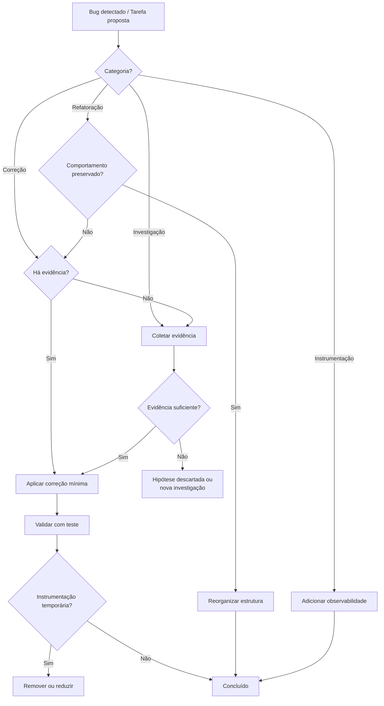

# 🧬 LINEAGE_MARKER: cc7017b56557586095e8dc6dae27b3e61feac8ab7bb9c2ca229a3723bc250524f3b65d01c3a7d148ba2f0282e63484bfb884f6425a36aba3cee3edd37b01e136
# ADR 0005 — Change Lifecycle: Separação entre Correção, Instrumentação e Investigação

- **Status**: Aceita
- **Data**: 2026-07-29
- **Contexto**: Durante análise de bugs em componentes críticos (pipeline, concorrência, memória, providers, AST), alterações de naturezas diferentes vinham sendo misturadas em uma mesma rodada de trabalho ou PR — especialmente em sistemas assíncronos onde sintomas se confundem com causas.

## Contexto

O iaglobal é um sistema altamente modular e descentralizado, com centenas de nós, providers assíncronos, semântica de PSC (único agente autorizado a chamar LLM cloud) e uma fronteira explícita entre corrigir comportamento e investigar falhas.

Antes desta decisão, era comum encontrar PRs que:

- Aumentavam timeout **e** alteravam contrato **e** adicionavam log no mesmo commit;
- "Resolve" um bug com `sleep()` adicional sem identificar deadlock real;
- Cancelavam `asyncio.Task`s silenciosamente sem diagnóstico de stack;
- Envolverem chamadas async em `try/except Exception` genérico apenas para "não quebrar a pipeline";
- Misturavam refatorações (rename, extração) com correções de bugs no mesmo diff — tornando `git bisect` inútil.

A consequência prática: correções baseadas em hipótese, regressões mascaradas, e dificuldade de auditar **o que** mudou em produção.

## Problema

Como distinguir formalmente:

1. **Investigação** (coletar evidência) vs. **Correção** (mudar comportamento)?
2. **Instrumentação** (observabilidade) de **Correção** disfarçada?
3. **Refatoração** (reorganização sem mudança de comportamento) de **Correção** silenciosa?

Sem essa distinção, o processo de revisão depende do bom senso individual de cada reviewer — que escala mal em projetos com 10+ colaboradores assíncronos.

## Decisão

Adotar **4 categorias mutuamente exclusivas** para classificar toda alteração:

| Categoria | Definição |
|-----------|-----------|
| **Investigação** | produz evidência antes de qualquer mudança comportamental |
| **Instrumentação** | adiciona observabilidade sem alterar comportamento |
| **Correção** | altera comportamento para eliminar defeito comprovado |
| **Refatoração** | reorganiza estrutura sem alterar comportamento observável |

Toda alteração MUST:

1. Ser classificada em **exatamente uma** categoria principal.
2. Ser sustentada por **evidência objetiva** (não hipótese).
3. Se envolver múltiplas categorias, SHOULD ser dividida em commits distintos.
4. Respeitar a **Regra 0** (não reverter trabalho alheio em curso).

A sequência obrigatória é:

```
Investigação
    ↓
Evidências
    ↓
Correção mínima
    ↓
Validação
    ↓
Remoção (ou redução) da instrumentação temporária
```

## Consequências

### Positivas

- **Code review objetivo**: existe um checklist de 9 perguntas (ver §7 do workflow).
- **`git bisect` confiável**: cada commit toca uma dimensão apenas.
- **Anti-band-aid**: 8 padrões proibidos explicitamente listados.
- **Auditabilidade**: histórico de incidentes mostra *o que foi investigado, o que foi corrigido, o que foi instrumentado*.
- **Integração com PSC**: o crítico (único autorizado a chamar LLM cloud) pode referenciar este workflow em suas decisões de escalação.

### Negativas / Custos

- **Mais commits por correção**: uma correção típica passa a ser 3-4 commits (instrumentação, investigação, correção, remoção). Aceitável dado o ganho de auditabilidade.
- **Disciplina adicional**: requer que cada contribuidor classifique sua mudança conscientemente antes de abrir PR.
- **Risco de over-instrumentação**: a tentação é deixar logs de debug permanentemente. Por isso a regra explícita "MAY permanecer quando atender as 4 condições".

## Fluxo obrigatório



## Referências

- Documento operacional: [`docs/engineering/change_lifecycle.md`](../engineering/change_lifecycle.md)
- Regra 0: [`AGENTS.md` — MCS — MCP Coordenation & Anti-Revert](../../AGENTS.md#-mcs--mcp-coordenation--anti-revert)
- Testing Standards: [`AGENTS.md` — 🧬 Testing Standards](../../AGENTS.md#-testing-standards)
- ADR-0004: Event Lineage Contract (precedente em governança de contratos)
